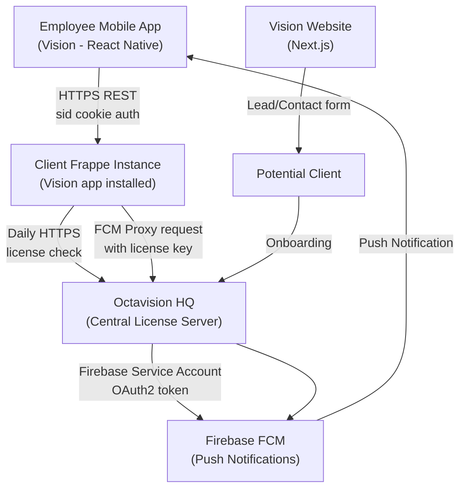
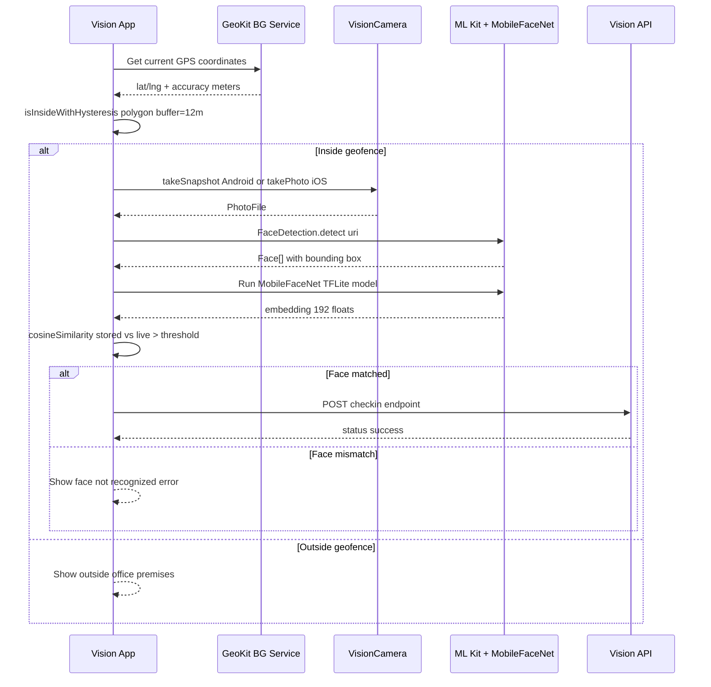
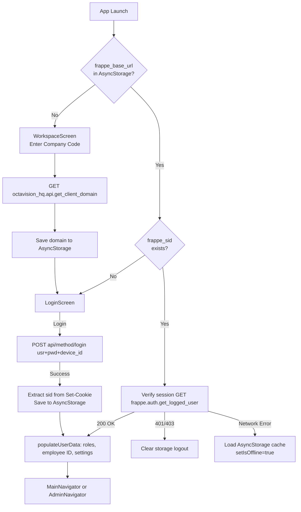
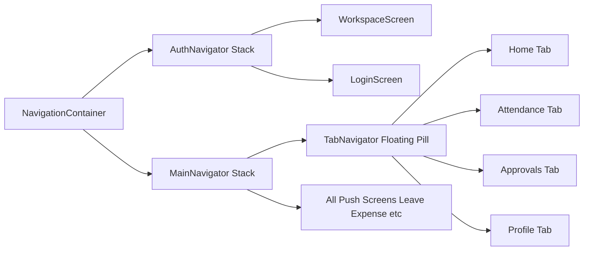
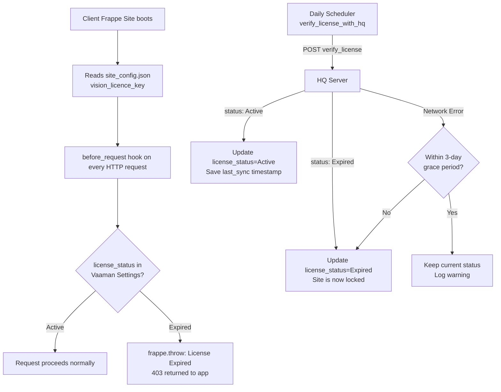
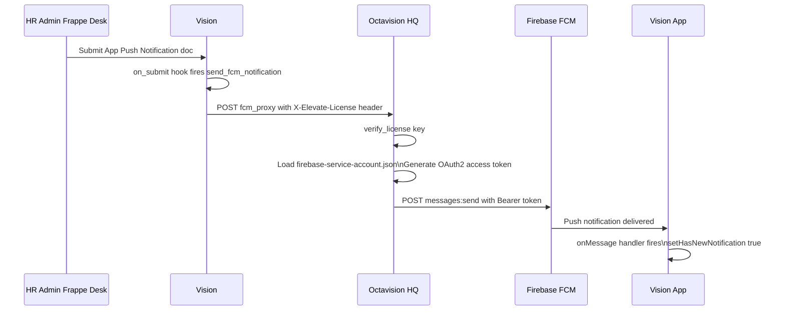

# 🧠 Vision - Complete Developer & Product Guide

> **Octavision Software Solution** | Built for Enterprise HR | v2.4 Stable

---

## 📋 Table of Contents

1. [Product Overview](#1-product-overview)
2. [System Architecture](#2-system-architecture)
3. [Repository Map](#3-repository-map)
4. [Repo 1 — Vision (React Native Mobile App)](#4-repo-1--vision-react-native-mobile-app)
5. [Repo 2 — Vision (Frappe Backend App)](#5-repo-2--elevate-hr-frappe-backend-app)
6. [Repo 3 — Octavision HQ (License & Gateway Server)](#6-repo-3--octavision-hq-license--gateway-server)
7. [Repo 4 — Vision Website (Next.js Marketing Site)](#7-repo-4--vision-website-nextjs-marketing-site)
8. [License & Kill-Switch System](#8-license--kill-switch-system)
9. [Face Recognition & Geofencing Deep Dive](#9-face-recognition--geofencing-deep-dive)
10. [FCM Push Notification Flow](#10-fcm-push-notification-flow)
11. [API Reference](#11-api-reference)

---

## 1. Product Overview

**Vision** is an enterprise-grade mobile HR companion app built on top of **Frappe/ERPNext**. It replaces physical biometric machines, paper leave forms, and manual payroll workflows with a single, secure mobile app.

### Core Value Pillars

| Pillar | Feature | Description |
|--------|---------|-------------|
| 🎯 Attendance | Face + Geo-fenced Punch | Employees check in only when physically inside geofenced premises, verified by MobileFaceNet biometrics |
| 📋 HR Workflows | Leave, Comp-Off, Shift | Full approval workflows from mobile — apply, track, approve |
| 💰 Finance | Payroll & Expense | View salary slips, submit expense claims with receipts |
| 🔔 Notifications | FCM Push | Real-time alerts for approvals, announcements |
| 🔐 Licensing | Kill-Switch | Server-side license enforcement via Octavision HQ |

### Product Stack at a Glance

```
┌────────────────────────────────────────────────────────────────┐
│                    Vision Mobile App (RN)                      │
│   React Native 0.76 · TypeScript · Firebase FCM · ML Kit      │
└────────────────────┬───────────────────────────────────────────┘
                     │ HTTPS (Frappe REST API / session cookie)
┌────────────────────▼───────────────────────────────────────────┐
│               Vision (Frappe App)                          │
│   Python 3.10+ · Frappe 15 · MariaDB · Redis · Nginx          │
└────────────────────┬───────────────────────────────────────────┘
                     │ HTTPS (License verification + FCM proxy)
┌────────────────────▼───────────────────────────────────────────┐
│           Octavision HQ (Central License Server)               │
│   Frappe App · "Elevate Client" DocType · Firebase SA Key      │
└────────────────────────────────────────────────────────────────┘

┌────────────────────────────────────────────────────────────────┐
│           Vision Website (Next.js 16 Marketing Site)           │
│   Next.js · React 19 · Tailwind CSS 4 · TypeScript 7          │
└────────────────────────────────────────────────────────────────┘
```

---

## 2. System Architecture



### Check-In Data Flow



---

## 3. Repository Map

| Repo | Path | Tech | Purpose |
|------|------|------|---------|
| **Vision** (Mobile) | `/mnt/ubuntu-data/dev/app/hello/vaaman/Vision/` | React Native 0.76, TypeScript | Main employee mobile app (Android + iOS) |
| **Vision** | `Vision/vision/` | Python, Frappe 15 | ERPNext custom app — HR logic, APIs, overrides |
| **Octavision HQ** | `Vision/octavision_hq/` | Python, Frappe | Central license server + FCM gateway |
| **Vision Website** | `Vision/vision-website/` | Next.js 16, React 19, Tailwind 4 | Marketing & demo site |

> [!NOTE]
> The mobile app **lives at the root** of the Vision directory — not in a subdirectory. `vision/` and `octavision_hq/` are Frappe apps installed on separate bench instances.

---

## 4. Repo 1 — Vision (React Native Mobile App)

### 4.1 Directory Structure

```
Vision/                          ← React Native root
├── App.tsx                      ← Root component, navigation container, FCM setup
├── index.js                     ← App registry entry point
├── package.json                 ← Dependencies (RN 0.76, Firebase, ML Kit, etc.)
├── android/                     ← Android native project
│   └── app/build.gradle         ← Gradle config (namespace: com.vision)
├── ios/                         ← iOS native project
├── assets/
│   └── models/mobilefacenet1.tflite  ← Face recognition model (REQUIRED)
└── src/
    ├── Components/              ← Reusable UI & complex modules
    │   ├── FaceScanner.tsx      ← Core biometric face scanner component
    │   ├── Menu.tsx             ← FAB menu (Leave, Expense, Attendance shortcuts)
    │   ├── Announcements.tsx
    │   ├── PendingRequests.tsx
    │   └── ui/                  ← Atomic UI kit
    │       ├── Button.tsx
    │       ├── Card.tsx
    │       ├── Calendar.tsx
    │       ├── Modal.tsx
    │       ├── Select.tsx
    │       ├── TextField.tsx
    │       ├── Skeleton.tsx     ← Loading placeholders
    │       └── charts/          ← Custom chart components (Bar, Area, Line, Donut, etc.)
    ├── context/
    │   ├── AuthContext.tsx       ← Global auth state, login/logout, settings fetch
    │   └── LoadingContext.tsx    ← Splash screen gating
    ├── Features/
    │   ├── Auth/
    │   │   ├── LoginScreen/     ← Username/password + workspace URL login
    │   │   └── WorkspaceScreen/ ← Company code → domain resolution via HQ
    │   └── Screens/
    │       ├── Home/            ← Dashboard with check-in card, quick actions
    │       ├── AttendanceScreen/ ← Calendar view, punch logs
    │       ├── AttendanceReqScreen/ ← Attendance regularization
    │       ├── LeaveScreen/     ← Leave list, apply, balance, edit
    │       ├── ShiftReqScreen/  ← Shift swap requests
    │       ├── FaceAndGeoScreen/ ← Face enrollment + geofence setup
    │       ├── Payroll/         ← Salary slips
    │       ├── ExpenseScreen/   ← Expense claims with receipts
    │       ├── CompOff/         ← Compensatory off requests
    │       ├── IssueScreen/     ← Helpdesk tickets
    │       ├── NotificationScreen/
    │       ├── ProfileScreen/   ← Personal, education, bank details
    │       ├── HolidayScreen/   ← Company holiday list
    │       ├── MapViewScreen/   ← All employees GPS map (manager)
    │       ├── ManagerScreen/   ← Manager dashboard
    │       ├── Admin/           ← Admin panel (user management, announcements)
    │       └── InternalReferral/ ← Job listings & referral tracking
    ├── navigation/
    │   ├── AuthNavigator.tsx    ← Workspace → Login flow
    │   ├── MainNavigator.tsx    ← Stack navigator wrapping tabs
    │   ├── TabNavigator.tsx     ← Floating pill tab bar (Home, Attendance, Approvals, Profile)
    │   └── AdminNavigator.tsx   ← Admin-only screens
    ├── theme/
    │   ├── theme.ts             ← Light/Dark color tokens
    │   ├── ThemeProvider.tsx
    │   └── useTheme.ts
    ├── types/
    │   └── index.ts             ← All TypeScript interfaces (AppStackParamList, etc.)
    └── utils/
        ├── frappe.ts            ← Axios-based Frappe API client (session cookie)
        ├── faceCapture.ts       ← Face detection pipeline (ML Kit + MobileFaceNet)
        ├── geo.ts               ← Geofence math (point-in-polygon, hysteresis)
        ├── cosine.ts            ← Cosine similarity for embedding matching
        ├── backgroundTask.ts    ← Background geolocation task
        ├── Notification.ts      ← Local notification helpers
        ├── PushNotificationHelper.js ← FCM token save + foreground handler
        ├── Permissions.ts       ← Camera, location permission requests
        ├── atsApi.ts            ← ATS (recruitment) API calls
        ├── vmsApi.ts            ← VMS (vehicle management) API calls
        └── prayogApi.ts         ← Prayog integration API calls
```

### 4.2 Key Dependencies

| Package | Purpose |
|---------|---------|
| `react-native` 0.76.x | Core framework |
| `@react-native-firebase/app` | FCM messaging |
| `@react-native-ml-kit/face-detection` | Google ML Kit face detection |
| `@infinitered/react-native-mlkit-core` | TFLite model runner (MobileFaceNet) |
| `react-native-vision-camera` | High-perf camera for face capture |
| `react-native-geo-activity-kit` | Background geolocation foreground service |
| `react-native-geolocation-service` | GPS coordinates |
| `react-native-maps` | Google Maps for manager view |
| `@bam.tech/react-native-image-resizer` | EXIF rotation baking for ML Kit |
| `@react-navigation/native` | Navigation container |
| `axios` | HTTP client |
| `@react-native-async-storage/async-storage` | Local storage (SID, cache) |
| `notifee` | Rich local notifications |

### 4.3 Authentication Flow



### 4.4 Navigation Architecture



### 4.5 Feature Gating

Features are dynamically enabled per employee/branch via `appSettings`:

```typescript
// AuthContext: fetched from vision.api2.get_vaamanhr_settings
appSettings = {
  branchFeatures: string[],    // Features enabled for the branch
  employeeFeatures: string[],  // Features overridden for this employee
}

// Usage in TabNavigator/Menu:
const isFeatureAllowed = (feature: string) =>
  appSettings?.branchFeatures?.includes(feature) ||
  appSettings?.employeeFeatures?.includes(feature);
```

---

## 5. Repo 2 — Vision (Frappe Backend App)

### 5.1 What It Is

`vision` is a **Frappe custom app** that sits on top of ERPNext's HR module. It is installed on the **client's Frappe bench instance**. It extends, overrides, and adds HR functionality.

### 5.2 Directory Structure

```
vision/
├── pyproject.toml               ← flit build config
├── vision/
│   ├── hooks.py                 ← Frappe app hooks (the backbone)
│   ├── modules.txt              ← Module: "Vision"
│   ├── api2.py                  ← Main API endpoints (login data, checkins, etc.)
│   ├── late_entry_atten.py      ← Scheduled: daily attendance policy processing
│   ├── holiday_policy.py        ← Sandwich leave policy (runs at 23:00 daily)
│   ├── purchase_invoice.py      ← Auto Purchase Invoice on PO receipt
│   ├── draft_purchase_invoice.py← Auto draft invoice creation
│   ├── setup/install.py         ← after_install: domains, default leave types
│   ├── overrides/
│   │   ├── attendance_request.py ← CustomAttendanceRequest class
│   │   ├── salary_slip.py       ← CustomSalarySlip class
│   │   └── leave_policy_assignment.py
│   ├── fixtures/custom_fields.json ← Custom fields exported for deployment
│   ├── patch/prorata_allocation.py
│   └── vision/              ← Core business logic subpackage
│       ├── api.py               ← Attendance DocType override (vision class)
│       ├── kill_switch.py       ← License guard + HQ verification
│       ├── compoff.py           ← CompOff (Compensatory Off) logic
│       ├── over_time.py         ← Overtime → Comp Off conversion
│       ├── weekly_off.py        ← Weekly off calculation for salary slips
│       ├── salary_slip_hooks.py ← Overtime hours on salary slip
│       ├── half_day_leaves.py   ← Half-day attendance validation
│       ├── head_office_policy.py← Head office policy enforcement
│       ├── update_field_options.py ← Post-migrate field option updates
│       ├── payment_reco.py      ← Payment reconciliation helpers
│       └── salery_component_field_add_buttton.py ← Salary component history
```

### 5.3 hooks.py — The Backbone

```python
# DocType Class Overrides
override_doctype_class = {
    "Attendance": "vision.vision.api.vision",
    "Attendance Request": "vision.overrides.attendance_request.CustomAttendanceRequest",
    "Compensatory Leave Request": "vision.vision.compoff.CompOff",
    "Leave Policy Assignment": "vision.overrides.leave_policy_assignment.CustomLeavePolicyAssignment",
    "Salary Slip": "vision.overrides.salary_slip.CustomSalarySlip"
}

# Document Events
doc_events = {
    "*": {
        "before_insert": "vision.vision.kill_switch.license_guard",
        "before_save": "vision.vision.kill_switch.license_guard",
    },
    "Attendance": {
        "after_insert": "vision.vision.half_day_leaves.validate_half_day_attendance"
    },
    "Salary Slip": {
        "before_save": "vision.vision.salary_slip_hooks.calculate_overtime_hours",
        "validate": ["...weekly_off.set_total_weekly_off", "...weekly_off.before_save"]
    },
    "App Push Notification": { "on_submit": "vision.api2.send_fcm_notification" },
    "App Announcement": { "on_submit": "vision.api2.send_fcm_notification" },
    "Purchase Receipt": { "on_submit": "vision.draft_purchase_invoice.auto_create_purchase_invoice" },
}

# Scheduled Tasks
scheduler_events = {
    "daily": [
        "vision.late_entry_atten.process_attendance_policy",
        "vision.vision.salery_component_field_add_buttton.update_history",
    ],
    "cron": {
        "0 23 * * *": ["vision.holiday_policy.process_holiday_sandwich_policy"]
    }
}

# Request Lifecycle Hook (runs on EVERY request)
before_request = ["vision.vision.kill_switch.check_license_before_request"]
```

### 5.4 Key Custom DocTypes

| DocType | Purpose |
|---------|---------|
| `Vaaman Settings` | Per-site config: `license_status`, `hq_url`, feature flags |
| `Employee Helper` | Per-employee: `fcm_token`, `face_embeddings`, `permission_banner_shown` |
| `App Push Notification` | Admin-created push notifications (triggers FCM on submit) |
| `App Announcement` | Company-wide announcements pushed via FCM |
| `OverTime Import` | Bulk overtime upload → auto Comp Off allocation |
| `Attendance Policy Log` | Tracks late entry penalty applications |
| `Location Log` | Employee GPS pings (used for auto-checkout) |
| `Branch Unit` | Branch/office with geofence polygon vertices |

### 5.5 Important API Endpoints

All in `api2.py` with `@frappe.whitelist()`:

| Endpoint | Method | Description |
|----------|--------|-------------|
| `vision.api2.get_user_login_data` | GET | Returns user doc, employee ID, roles |
| `vision.api2.get_vaamanhr_settings` | GET | App settings: feature flags, face embeddings, shift cushion |
| `vision.api2.save_fcm_token` | POST | Saves FCM device token to Employee Helper |
| `vision.api2.send_fcm_notification` | Hook | Triggered on App Push Notification submit |
| `vision.api2.daily_auto_checkout` | Scheduled | Auto-checkout employees who forgot to punch out |

### 5.6 site_config.json Required Keys

Every client Frappe site needs these:

```json
{
  "vision_licence_key": "YOUR-LICENSE-KEY-HERE",
  "hq_url": "https://cnd.octavision.in",
  "client_license_key": "YOUR-LICENSE-KEY-HERE"
}
```

---

## 6. Repo 3 — Octavision HQ (License & Gateway Server)

### 6.1 What It Is

`octavision_hq` runs on **Octavision's own server** at `https://cnd.octavision.in`. It acts as:

1. **License Registry** — manages `Elevate Client` DocType
2. **FCM Proxy Gateway** — holds Firebase Service Account; client sites don't need it directly

### 6.2 API Endpoints

All `@frappe.whitelist(allow_guest=True)`:

| Endpoint | Used By | Purpose |
|----------|---------|---------|
| `octavision_hq.api.get_client_domain` | Mobile App (WorkspaceScreen) | Company code → Frappe domain |
| `octavision_hq.api.verify_license` | Vision (daily scheduler) | License key → Active/Expired |
| `octavision_hq.api.fcm_proxy` | Vision (push notifications) | Proxy FCM v1 requests via SA key |

### 6.3 Elevate Client DocType

```
Elevate Client:
  - company_code  (string)  → e.g. "ACME2024"
  - client_domain (string)  → e.g. "https://acme.frappe.cloud"
  - license_key   (string)  → UUID-style key
  - status        (Select)  → "Active" | "Expired" | "Suspended"
```

### 6.4 Firebase Service Account Setup

```bash
# Place at the HQ Frappe site:
cp firebase-service-account.json \
  sites/hq.octavision.in/private/files/firebase-service-account.json

# Or configure path in site_config.json:
# {"fcm_credentials_path": "/absolute/path/to/firebase-service-account.json"}
```

---

## 7. Repo 4 — Vision Website (Next.js Marketing Site)

### 7.1 Tech Stack

| Tool | Version | Role |
|------|---------|------|
| Next.js | ^16.3.5 | App Router, SSR |
| React | ^19.2.8 | UI library |
| TypeScript | ^7.0.2 | Type safety |
| Tailwind CSS | ^4.3.3 | Styling |
| Lucide React | ^1.47.0 | Icons |

### 7.2 Page Sections

| Section | ID | Description |
|---------|-----|-------------|
| Navbar | — | Sticky nav with QR + Download CTA |
| Hero + Simulator | `#simulator` | Rotating word animation + interactive phone frame demo |
| Stats Bar | — | 99.8% accuracy, less than 3s biometric, 100% paperless |
| Features / Pillars | `#features` | Face+Geo, Leave/Comp-Off, Payroll (scroll reveal) |
| App Modules | `#modules` | Filterable grid of all 11 app modules |
| Security | `#security` | AES-256, anti-spoof, RBAC details |
| Download | `#download` | Android APK / iOS Store / QR scanner |
| Contact | `#contact` | Email + phone contact form |

---

## 8. License & Kill-Switch System

### 8.1 Flow



### 8.2 Grace Period

- Every successful license sync saves a `last_sync` timestamp in `frappe.db` defaults
- If HQ is unreachable: site stays Active for **3 days** after last successful sync
- After 3 days without a successful sync → locks to Expired

### 8.3 Always-Bypassed Endpoints

Even with an expired license, these are never blocked:
- `Guest` and `Administrator` sessions
- `/api/method/logout`
- `/api/method/octavision_hq.*`
- Core Frappe doctypes: `User`, `Error Log`, `System Settings`, `Vaaman Settings`, etc.

### 8.4 Mobile App Response

When app receives a license error, `AuthContext` fires `onLicenseExpired` event:
1. Shows alert about expired subscription
2. Calls `logout()` — clears session  
3. Clears `frappe_base_url` from AsyncStorage
4. User must re-enter company code

---

## 9. Face Recognition & Geofencing Deep Dive

### 9.1 Face Recognition Pipeline

```
VisionCamera Frame
      ↓
takeSnapshot() [Android] / takePhoto() [iOS]
      ↓
ImageResizer: rotate by EXIF orientation → upright 1280×1280 JPEG
      ↓
ML Kit FaceDetection.detect() → Face[] with bounding box
      ↓
Crop face region with 25% padding (buildFaceCropRegion)
      ↓
MobileFaceNet TFLite model → embedding[192 floats]
      ↓
cosineSimilarity(storedEmbeddings[], liveEmbedding)
      ↓
best score > threshold? (iOS: 0.55, Android: 0.70)
      ↓
Check-in allowed / rejected
```

> [!IMPORTANT]
> The TFLite model file `assets/models/mobilefacenet1.tflite` is **required** at build time. The app will not function without it.

### 9.2 Face Enrollment

1. Employee opens **Face & Geo** screen
2. Captures multiple frames via `VideoFaceEnrollment`
3. Each frame produces an embedding vector
4. All embeddings saved to `Employee Helper.face_embeddings` (JSON array of arrays)
5. On check-in, live embedding is compared to **all** stored embeddings (best match wins)

### 9.3 Geofence Algorithm

```typescript
// geo.ts — hysteresis-aware point-in-polygon
function isInsideWithHysteresis(
  point: Point,         // Current GPS coords
  polygon: Point[],     // Office polygon vertices from Branch Unit
  currentlyOutOfZone: boolean,
  bufferMeters = 12,    // 12m buffer prevents flickering at boundary
  accuracyMeters = 0,   // GPS reported accuracy
  accuracyCapMeters?,   // Cap to avoid poor GPS locking you out
): boolean
```

- **Entry**: strict point-in-polygon (no buffer) — must be definitively inside
- **Exit**: only when `edgeDistance > bufferMeters + effectiveAccuracy`
- This prevents "geofence bounce" where GPS jitter causes repeated in/out events

---

## 10. FCM Push Notification Flow



### FCM Token Registration

1. App calls `messaging().getToken()` on login
2. POSTs to `vision.api2.save_fcm_token(employee, fcm_token)`
3. Token saved in `Employee Helper.fcm_token`
4. Also subscribes to `all_users` FCM topic for broadcast notifications

---

## 11. API Reference

### Vision (`vision.api2`)

#### `get_user_login_data`
```
GET /api/method/vision.api2.get_user_login_data?user_id=user@example.com
Auth: frappe_sid cookie

Response:
{
  "message": {
    "user_doc": { "name", "first_name", "email", "roles": [] },
    "employee_id": "EMP-0001",
    "roles": [{"role": "Employee"}]
  }
}
```

#### `get_vaamanhr_settings`
```
GET /api/method/vision.api2.get_vaamanhr_settings
Auth: frappe_sid cookie

Response:
{
  "message": {
    "shift_end_cushion": 30,
    "app_version": 24,
    "attendance_by": "Face",
    "branch_features": ["Leave", "Attendance", "Expense Claim"],
    "employee_features": [],
    "employee_helper": {
      "name": "EH-00001",
      "fcm_token": "...",
      "face_embeddings": [[...], [...]],
      "permission_banner_shown": true,
      "attendance_by": "Face"
    }
  }
}
```

#### `save_fcm_token`
```
POST /api/method/vision.api2.save_fcm_token
Body: {"employee": "EMP-0001", "fcm_token": "device_token_here"}

Response: {"message": {"status": "success", "message": "Token saved"}}
```

### Octavision HQ (`octavision_hq.api`)

#### `get_client_domain`
```
GET /api/method/octavision_hq.api.get_client_domain?company_code=ACME2024
No auth required

Response: {"message": {"domain": "https://acme.frappe.cloud"}}
Error:    frappe.throw("Invalid Company Code") / "License Expired"
```

#### `verify_license`
```
POST /api/method/octavision_hq.api.verify_license
Body: {"license_key": "uuid-license-key"}
No auth required

Response: {"message": {"status": "Active"}}
      or: {"message": {"status": "Expired"}}
```

#### `fcm_proxy`
```
POST /api/method/octavision_hq.api.fcm_proxy
Header: X-Elevate-License: Bearer LICENSE_KEY
Content-Type: application/json
Body: { FCM v1 message payload }

Response: FCM API response (name: message-id on success)
Error:    frappe.throw("License Expired") if inactive
          frappe.throw("HQ Firebase Auth Failed") if SA key missing
```

---

> Built with ❤️ by **Octavision Software Solution**
> Contact: `info@octavision.com` 
